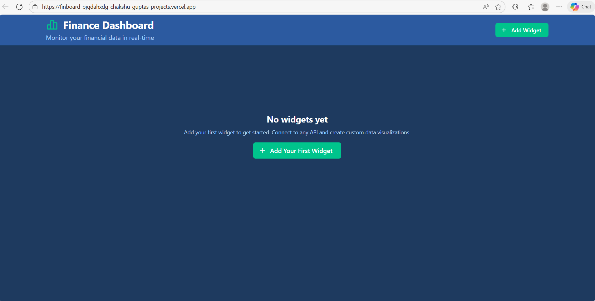
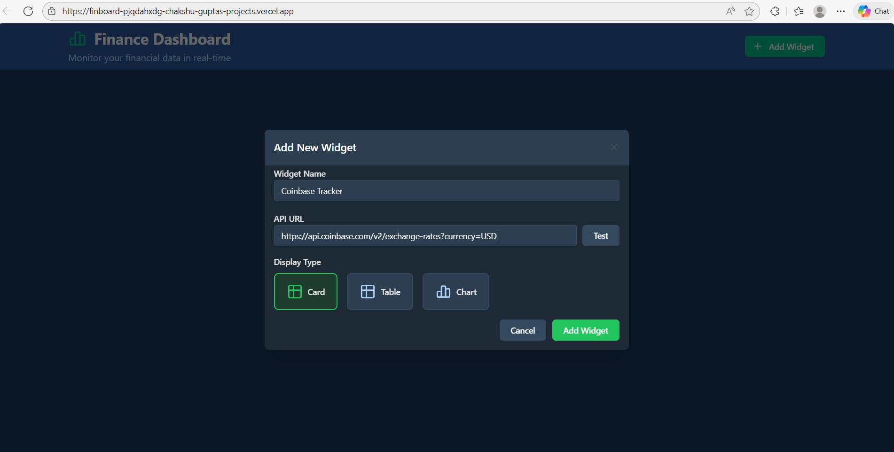
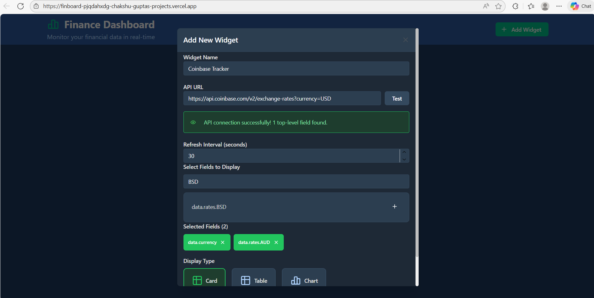
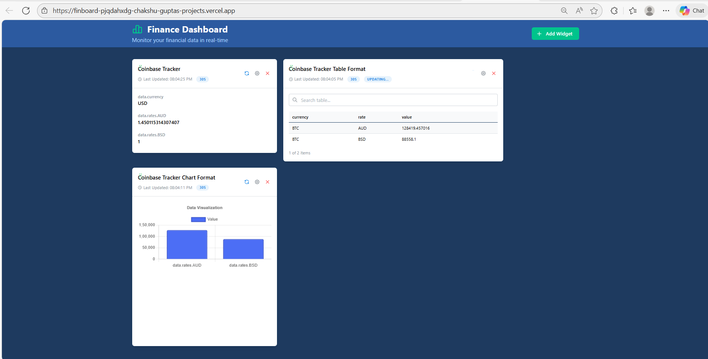
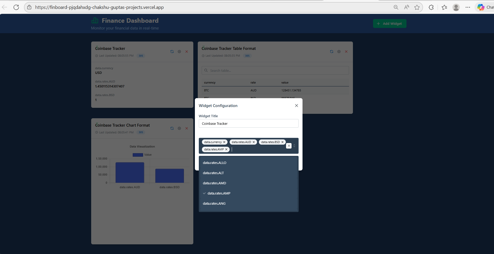
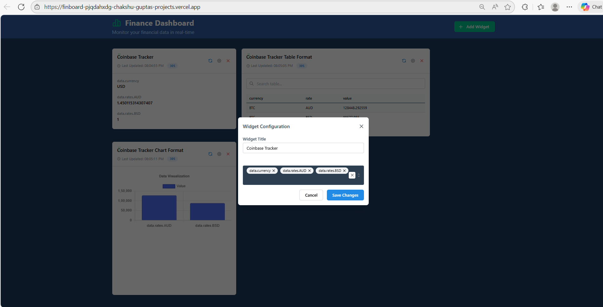
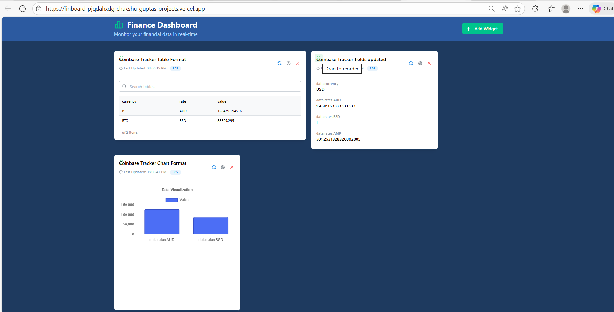
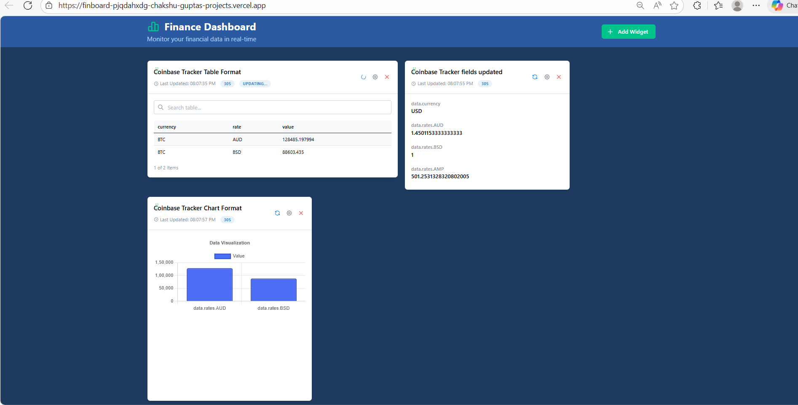
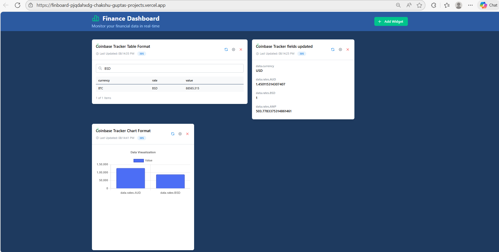
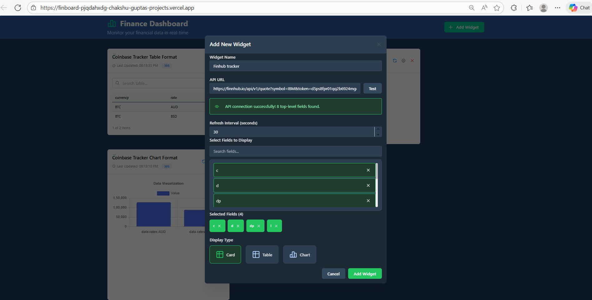

Vercel Link: finboard-blue.vercel.app

# FinBoard - Finance Dashboard

A modern, configurable finance dashboard built with Next.js, React, and Redux. Connect to any API and create custom data visualizations with real-time data updates.

## Features

- **Dynamic Widget System**: Create and configure widgets that display data in different formats
- **Multiple Display Types**: 
  - Card Display for key metrics
  - Table Display for detailed data
  - Chart Display for visual analytics
- **Real-time Data Updates**: Configurable refresh intervals for automatic data synchronization
- **Drag-and-Drop Interface**: Reorder widgets using drag-and-drop functionality
- **API Integration**: Connect to any REST API and automatically extract available fields
- **Field Selection**: Choose which fields to display from your API response
- **Responsive Design**: Works seamlessly on desktop and responsive layouts
- **Local Storage**: Widgets and configurations are persisted to browser storage
- **Dark Theme**: Modern dark UI with accessible color scheme
- **Lazy Loading**: Components load on-demand for better performance

## Technology Stack

- **Frontend Framework**: [Next.js 16.1.4](https://nextjs.org)
- **UI Library**: [Mantine](https://mantine.dev)
- **State Management**: [Redux Toolkit](https://redux-toolkit.js.org)
- **Drag & Drop**: [@dnd-kit](https://docs.dndkit.com)
- **Charts**: [Chart.js](https://www.chartjs.org)
- **Styling**: CSS with CSS Variables
- **Icons**: [Tabler Icons](https://tabler-icons.io)
- **Language**: TypeScript

## Prerequisites

Before running the project, ensure you have the following installed:
- Node.js (v16 or higher)
- npm or yarn

## Installation

1. Clone the repository:
```bash
git clone <repository-url>
```

2. Install dependencies:
```bash
npm install
# or
yarn install
```

## Running the Development Server

Start the development server:

```bash
npm run dev
# or
yarn dev
# or
pnpm dev
# or
bun dev
```

Open [http://localhost:3000](http://localhost:3000) with your browser to see the dashboard.

The application will automatically reload when you make changes to the code.

## Screenshots
### 🏠 Finboard Landing Page


### ➕ Add New Widget


### 🧩 Select Fields to Display


### 📊 Widget Cards – Different Views


### ⚙️ Widget Configuration – Select Fields


### 🛠 Widget Configuration – Update Settings


### 🔀 Reordering Widgets (Drag & Drop)


### 🔄 Real-time Auto Refresh


### 🔍 Search in Table Data


### 🔗 Finnhub API Connection



## Building for Production

Create an optimized production build:

```bash
npm run build
# or
yarn build
```

Start the production server:

```bash
npm start
# or
yarn start
```

## Project Structure

```
finboard/
├── app/
│   ├── components/          # React components
│   │   ├── Dashboard.tsx
│   │   ├── AddWidgetModal.tsx
│   │   ├── Widget.tsx
│   │   ├── WidgetConfiguration.tsx
│   │   ├── CardDisplay.tsx
│   │   ├── TableDisplay.tsx
│   │   ├── ChartDisplay.tsx
│   │   └── ...
│   ├── layout.tsx           # Root layout with Redux Provider
│   ├── page.tsx             # Home page
│   ├── globals.css          # Global styles and CSS variables
│   └── providers.tsx        # Redux Provider setup
├── lib/
│   └── store/               # Redux store configuration
│       ├── store.ts
│       ├── widgetSlice.ts
│       ├── index.ts
│       └── hooks.ts
├── public/                  # Static assets
├── package.json
├── tsconfig.json
└── next.config.ts
```

## How to Use

1. **Add a Widget**: Click the "Add Widget" button to create a new widget
2. **Configure API**: Enter the API URL and click "Test" to validate and extract available fields
3. **Select Fields**: Choose which fields you want to display from the API response
4. **Choose Display Type**: Select how to display the data (Card, Table, or Chart)
5. **Set Refresh Interval**: Define how often the data should refresh (5-300 seconds)
6. **Save & View**: Click "Add Widget" to create the widget and view it on the dashboard
7. **Reorder Widgets**: Drag and drop widgets to rearrange them
8. **Edit Widget**: Click the settings icon to modify widget configuration
9. **Delete Widget**: Click the delete icon to remove a widget

## Learn More

To learn more about the technologies used:
- [Next.js Documentation](https://nextjs.org/docs)
- [Mantine Documentation](https://mantine.dev/guides/getting-started/)
- [Redux Toolkit Documentation](https://redux-toolkit.js.org/)
- [TypeScript Documentation](https://www.typescriptlang.org/docs/)

Happy Coding!!
